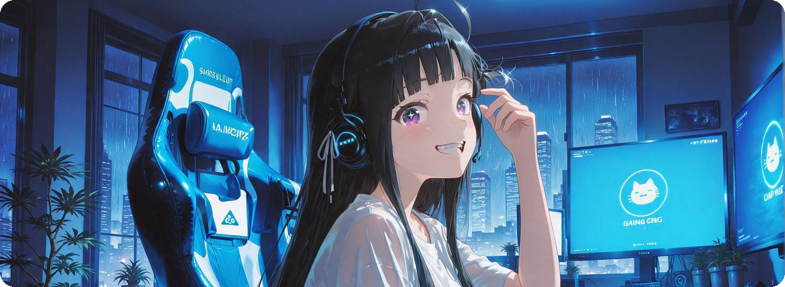

  
  <h1>mengzi</h1>
  
🎧 网易云重度用户 &nbsp;·&nbsp; 🛠 在项目里修 bug &nbsp;·&nbsp; 🐟 专业摸鱼

 

物联网工程在读 个人开发者 没心没肺之人

### 🎧 最近在折腾

- 互帮互助(提pr)
- 给别人的项目捣乱(提issues)
- 跟一块单片机板子互相较劲，目前它占上风

### 📮 找得到我

- Instagram [@call_me_mengzi](https://www.instagram.com/call_me_mengzi/)

如果代码能跑，就别动它。

封面 <a href="https://www.pixiv.net/artworks/149381128">《Pleia正在上线》</a> · <a href="https://www.pixiv.net/en/users/43689242">Unended Gloom</a>（Girls Band Cry 同人）

<!--
=========================================================
  想加的时候从这里挑，删掉注释开头结尾两行即可
=========================================================

【换横幅】把图放进 assets/ 后改顶部那行 src：
  

【想提一句在看什么】塞进 🎧 那节，跟音乐放一起挺自然：
  - 最近在补《孤独摇滚！》和 BanG Dream!，Band 番比代码好懂

【以后有了自己的项目】在「最近在折腾」前面加：
  ### 🧩 自己写的
  - [项目名](链接)：一句话说清它干嘛的
-->
